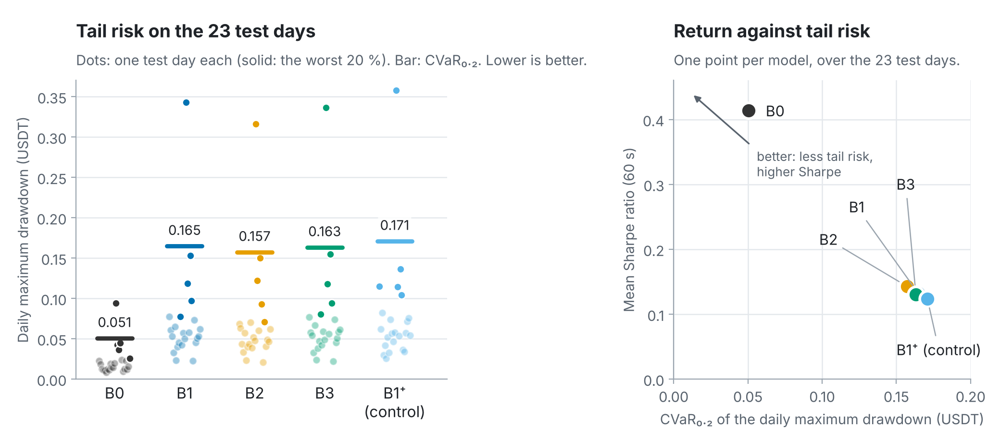
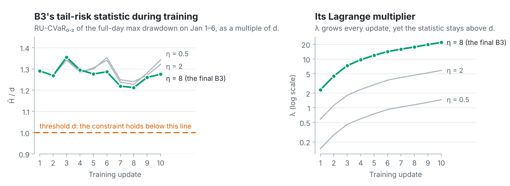

<div align="center">

# Beyond Reward Shaping

**CVaR-constrained reinforcement learning for Avellaneda–Stoikov market making**

MSc thesis in Computational Science · University of Amsterdam · 2026

[](https://github.com/AA-ron2/cvar-market-making/actions/workflows/tests.yml)
[](https://github.com/AA-ron2/cvar-market-making/releases/latest)
[](LICENSE)
[](pyproject.toml)

</div>

<p align="center">
  
</p>

Can a market-making agent be kept away from large drawdowns more reliably by **constraining** its tail risk than by
**penalising** drawdowns in its reward? In every model here, the Avellaneda–Stoikov formulas set the bid and ask
quotes, and a policy chooses the risk aversion γ and a quote skew. The models are trained and selected on Binance Spot
DOGEUSDT order-book replays of 1–6 January 2025 and compared on the 23 retrospective out-of-sample days that follow,
with a best-price-reach execution proxy. The trading day is the unit of inference.

## Key findings

- **B3's constraint was not met during training.** B3, a PPO-Lagrangian with a constraint on the CVaR₀.₂ of the
  full-day maximum drawdown, stayed above its threshold d on its training days for all k = 10 updates, although its
  multiplier λ grew at every update.
- **No evidence that the constraint changed the tail risk out of sample.** The primary tests give no evidence that B3
  changes the CVaR₀.₂ of the daily maximum drawdown relative to unconstrained PPO (B1; Δ −0.0016 USDT, Holm-adjusted
  p 0.496) or relative to the drawdown penalty (B2; Δ +0.0059 USDT, Holm-adjusted p 0.335).
- **The analytical baseline did best.** B0, Avellaneda–Stoikov with a fixed γ, had the lowest CVaR₀.₂ (0.0505 USDT)
  and the highest Sharpe ratio (0.414) of the five models.
- **A pre-registered paper-trading test** ran B0 and B3 on live order books for two days with Hummingbot. It is
  descriptive only ([below](#forward-test)).

## Results

<picture>
  <source media="(prefers-color-scheme: dark)" srcset="docs/figures/results-dark.png">
  
</picture>

<!-- results-table: generated by scripts/analysis/make_readme_assets.py -->
| Model | Sharpe (60 s) | CVaR₀.₂ of daily MaxDD | Mean daily MaxDD | Final P&L | Mean \|q\| (DOGE) |
|---|---:|---:|---:|---:|---:|
| B0 | **0.414** | **0.0505** | 0.0223 | 0.521 | 1.18 |
| B1 | 0.132 | 0.1647 | 0.0739 | 0.459 | 4.41 |
| B2 | 0.143 | 0.1572 | 0.0700 | 0.461 | 3.89 |
| B3 | 0.131 | 0.1631 | 0.0737 | 0.456 | 4.50 |
| B1⁺ (control) | 0.124 | 0.1709 | 0.0770 | 0.452 | 5.07 |

Means over the 23 seed-averaged test days (each day: 2 fill seeds × 20 paths, deterministic actions); drawdowns and P&L in USDT.
The CVaR₀.₂ is the mean of the worst 20 % of the days (0.2 × 23 = 4.6 days: the worst four and 0.6 of the fifth).

| Primary contrast (CVaR₀.₂ of daily MaxDD) | Δ (USDT) | p | Holm-adjusted p |
|---|---:|---:|---:|
| B3 − B1 | −0.0016 | 0.496 | 0.496 |
| B3 − B2 | +0.0059 | 0.167 | 0.335 |

p: within-day label-swap randomization test, 10,000 draws; Holm over the two primary contrasts. Neither result is
evidence for a difference, nor for equivalence.
<!-- /results-table -->

**Why B3 barely moved.** During training, B3's tail-risk statistic Ĥ stayed 1.2–1.4 times the threshold d while the
Lagrange multiplier grew from about 2 to 22. The policy moved little from B1, so B3 behaves almost like B1 out of
sample ([design decision D-24](docs/design_decisions.md)).

<picture>
  <source media="(prefers-color-scheme: dark)" srcset="docs/figures/b3_training-dark.png">
  
</picture>

The tables come from [`results/final/main/`](results/final/main/), and
[docs/reproduce.md](docs/reproduce.md#where-each-thesis-table-comes-from) maps each table and figure of the thesis to
its file.

## The five models

| Model | What it is |
|---|---|
| B0 | Analytical Avellaneda–Stoikov with a fixed γ = 0.891, tuned on Jan 1–6 |
| B1 | Unconstrained PPO choosing γ and the quote skew |
| B2 | B1 fine-tuned with the fixed penalty −α·E[full-day MaxDD] in its objective, α = 1 selected on Jan 5–6 (penalty-based reward design) |
| B3 | B1 fine-tuned as a PPO-Lagrangian under the constraint CVaR₀.₂(full-day MaxDD) ≤ d, with d = 0.8 × B1's CVaR₀.₂ on the training days and η = 8 selected by a training-only rule |
| B1⁺ | Control: B1 fine-tuned like B2 and B3 (k = 10 updates, the same learning rate), without a risk term |

Training and selection use 2025-01-01 to 2025-01-06; the test days are 2025-01-07 to 2025-01-29.
[docs/model.md](docs/model.md) gives the equations, and [docs/design_decisions.md](docs/design_decisions.md) the
design decisions and their reasons.

## Quick start

Python 3.11. The same install commands as the tests workflow (CPU torch at the lock's version, the rest of the lock as
constraints), then the data-free tests:

```bash
python -m pip install "torch==2.11.0" --index-url https://download.pytorch.org/whl/cpu
grep -v -E '^(torch|torchvision|torchaudio|triton)==|^nvidia-' requirements-lock.txt > constraints.txt
python -m pip install -c constraints.txt -e ".[test]"
python -m pytest -q -rs tests
python -m pytest -q -rs hummingbot_adapter/tests
```

The tests that need the market data (`DATA_DIR`) or the forward test's frozen inputs (`HB_ARTIFACTS`) skip without
them. Some tests run `bash`, `git` and `sha256sum`.

## Reproducing the thesis

[docs/reproduce.md](docs/reproduce.md) describes the environment, the data, the two pipeline stages and the
go/no-go review between them. The market data is licensed third-party data and is not included
([data/README.md](data/README.md)). The corrected pipeline took about 10,541 core-hours on SURF Snellius, 3,707 of them
for the final stage.

## Trained models

The final B1, B2, B3 and B1⁺ models and their normalizers are assets of the
[GitHub release v1.0.0](https://github.com/AA-ron2/cvar-market-making/releases/tag/v1.0.0). Load a model with
`stable_baselines3.PPO.load(path, device="cpu")` and a normalizer with `pickle.load`; neither needs this repository's
code. To check them, download the eight files and the release's `SHA256SUMS` into one folder:

```bash
python scripts/analysis/verify_release.py --assets <folder>   # in a checkout: the assets and results/final/
sha256sum -c SHA256SUMS                                       # in the download folder: the assets alone
```

B3's model and the four normalizers are byte-identical to the thesis files. The three other model files (B1, B2,
B1⁺) had one metadata field, a training-log path, cleared; their weights are unchanged
([results/final/REDACTIONS.md](results/final/REDACTIONS.md) gives the hash of every archive member).

<details>
<summary>The eight assets with their SHA-256</summary>

| Asset | Bytes | SHA-256 |
|---|---|---|
| `ppo_b1_doge.zip` | 142,797 | `83a6657ef15c80f4f80c7a58b720144496b82ba91a4515b47da15f4c18eff35c` |
| `ppo_b2_doge.zip` | 143,877 | `3e241e00c5ded5f085dc0d9c043dd5ec12e4cfdd6a0d3ba113d7c4881ee6b944` |
| `ppo_b1plus_doge.zip` | 143,877 | `2bdcc30a077bd8eabc9c77a719ab6ed20f06d81432b43174ec035892b4ecae0b` |
| `ppo_b3_doge.zip` | 143,877 | `05ee4c97524456a6445f54cfe0a4bf353ccd539c20060f1176b83455cebe4e53` |
| `vecnorm_b1.pkl` | 1,970 | `f53cbb84b213f04c20e2cdf2fcf24bba50f34b5cfa4615bf6b6875ca5a5d2f53` |
| `vecnorm_b2.pkl` | 2,581 | `d2be858e002d3b1e5a32bbe65822de3a4686cdbb91a81b8636241460a9b009b9` |
| `vecnorm_b1plus.pkl` | 2,581 | `d2be858e002d3b1e5a32bbe65822de3a4686cdbb91a81b8636241460a9b009b9` |
| `vecnorm_b3.pkl` | 2,581 | `d2be858e002d3b1e5a32bbe65822de3a4686cdbb91a81b8636241460a9b009b9` |

</details>

## Forward test

A pre-registered forward test ran B0 and B3 as Hummingbot 2.17.0 paper-trading bots on Binance Spot DOGE-USDT on the
UTC days 2026-10-22 and 2026-10-23. It is descriptive only and makes no inferential claim. The thesis reports it in
Appendix B, "Hummingbot forward validation (paper-trading deployment test)".
[hummingbot_adapter/README.md](hummingbot_adapter/README.md) describes the protocol, the run and the analysis.

## Repository layout

```text
cvar_mm/                     the thesis package: replay environment, calibration, A–S quotes, B0, PPO fine-tuning,
                             the CVaR-Lagrangian, metrics and inference
scripts/pipeline/            the Slurm pipeline that produced the thesis results (two stages)
scripts/analysis/            the size study of the primary test, verify_release.py, make_readme_assets.py
configs/final_pipeline.env   the frozen configuration of the pipeline
tests/                       tests of the package and the pipeline (no market data needed)
hummingbot_adapter/          the Hummingbot paper-trading forward test of B0 and B3
results/final/               the thesis's result tables and the forward test's outputs
docs/                        model.md, design_decisions.md, reproduce.md, figures/
data/                        where the market data goes (licensed, not included)
```

<details>
<summary>Provenance</summary>

- This repository is an export of the private research repository's commits tagged `thesis-final-cf3096d` (the code
  behind every thesis result) and `public-export-source-v1.0.0` (that code with the forward test's branches).
- The package `procs` is renamed `cvar_mm`, and `scripts/snellius` is `scripts/pipeline`. The frozen records
  (PROTOCOL.md, the calibration file, RUN_LOG.md and the published results) keep the old names.
- The forward test's pre-registration is private commit a13d97c (tag `forward-test-preregistration-a13d97c`), with
  PROTOCOL.md SHA-256 `55e486031470d78fbb5ddbcef5b22091ac900d30059ff814b6de06b23facaadd`, committed
  2026-10-18T21:55:13Z. The public copy differs from it only in one local path.
- [results/final/REDACTIONS.md](results/final/REDACTIONS.md) lists every published file that differs from its
  original, with both hashes.

</details>

## Citation and licence

Please cite the software with [CITATION.cff](CITATION.cff) (GitHub's "Cite this repository" button uses it).

BSD 3-Clause; see [LICENSE](LICENSE). Parts of `cvar_mm` are adapted from mbt-gym (BSD 3-Clause), with its notice in
[THIRD_PARTY_NOTICES.md](THIRD_PARTY_NOTICES.md). Hummingbot (Apache License 2.0) is a runtime dependency of the
forward test and is not included.
