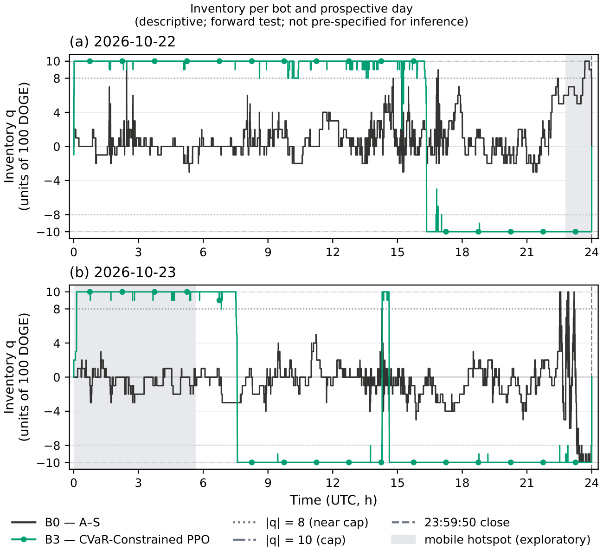

# Hummingbot forward test (B0 and B3)

This package runs two of the thesis's models, the analytical baseline B0 and the CVaR-constrained B3, as paper-trading
bots in Hummingbot 2.17.0 (`binance_paper_trade`) on live Binance Spot DOGE-USDT order books. It ran for two
pre-registered UTC days, 2026-10-22 and 2026-10-23. The test is descriptive only: it makes no inferential claim and
does not feed back into the thesis's model choices. The thesis reports it in Appendix B, "Hummingbot forward
validation (paper-trading deployment test)".

The bots reuse the frozen thesis code rather than a copy of it. Quotes come from
`cvar_mm.gym.formula_as.avellaneda_stoikov_quotes`, B3's observation features are re-implemented expression for
expression, and B3's actor runs in NumPy from the exported weights. Parity tests on the 2025-01-07 replay day (they
need `HB_ARTIFACTS`) check that the bot's step function, features, policy and quotes reproduce the simulator's.

## Files

| File | What it is |
|---|---|
| [`PROTOCOL.md`](PROTOCOL.md) | The pre-registered protocol (below) |
| [`RUN_LOG.md`](RUN_LOG.md) | The run log, a redacted copy (below) |
| [`ANALYSIS.md`](ANALYSIS.md) | How the analysis and the shadow replay ran, and the readings fixed where PROTOCOL §9 is silent |
| `hb_forward_bot.py`, `bot_core.py`, `bot_config.py` | The bot: a thin Hummingbot strategy shell around `BotCore`, and its settings and input checks |
| `execution.py`, `features.py`, `policy.py`, `quotes.py` | Order rules, B3's features, B3's NumPy actor, and the A–S quotes and orders |
| `telemetry.py`, `monitor.py` | The per-day output files (snapshots in the CSV layout of the thesis's market data, steps, orders, fills, health), clock checks and health probes |
| `calibrate.py` | The pre-registered calibration rule (PROTOCOL §4) |
| `export_policy.py` | Exports B3's frozen actor and normalizer to NumPy arrays, refusing a model whose hash differs from the profile record |
| `analysis.py`, `shadow_replay.py` | The forward-test analysis (PROTOCOL §9) and the shadow replay of each bot-day in the frozen simulator |
| `run_log.py`, `smoke_check.py`, `clear_halt.py` | Operations: clock incidents into RUN_LOG.md, the checks of a bot day, clearing a halt |
| [`deploy/`](deploy/README.md) | Docker Compose deployment on Windows (PowerShell scripts, bot configs) |
| [`tools/`](tools/README.md) | Helpers that ran beside the test: the clock-correction check, the clock logger and the Slurm job of the shadow replay |
| `tests/` | The adapter's tests; those that need the frozen inputs skip without `HB_ARTIFACTS` |

## The pre-registration (PROTOCOL.md)

The protocol was pre-registered in the private research repository, commit a13d97c (tag
`forward-test-preregistration-a13d97c`), committed 2026-10-18T21:55:13Z, with PROTOCOL.md's SHA-256
`55e486031470d78fbb5ddbcef5b22091ac900d30059ff814b6de06b23facaadd`. The public copy differs from it only in one local
path: the Windows user name in a folder path (line 366) is replaced by AA-ron2. Its SHA-256 is
`f37c542584989d04483c31165663830b5f1f095dd6af5f14a7d28b7de8e7838a`. Nothing else in it changed.

## The run log and the analysis

`RUN_LOG.md` is a redacted copy of the run log. Its first line names the original: tag `forward-test-run-end-3d362e5`,
SHA-256 `39bba7d74cd1a5e311ebc3226775ae3f981d7e84c1a24fe18a81244187b25042`. The redaction replaces local paths with
placeholders and removes network specifics (VPN details, IP addresses, the host's time-service settings); every
timestamp, decision, incident and measurement is kept. `ANALYSIS.md` is the analysis record, with paths as
placeholders. `results/final/REDACTIONS.md` lists every changed file.

## Old module names in the frozen records

The thesis code ran as the package `procs` with the pipeline scripts in `scripts/snellius`. This repository renames them
`cvar_mm` and `scripts/pipeline`; nothing else in the code changed with the rename. The frozen records keep the old
names as history: PROTOCOL.md, `config/hb_calibration.json` (its `procedure` string), RUN_LOG.md and the published
results. Read them with the mapping

| In the frozen records | In this repository |
|---|---|
| `procs/`, `procs.gym.calibration`, `procs.gym.data_loader`, `procs.gym.formula_as`, ... | `cvar_mm/`, `cvar_mm.gym.calibration`, `cvar_mm.gym.data_loader`, `cvar_mm.gym.formula_as`, ... |
| `scripts/snellius/`, `scripts.snellius.common` | `scripts/pipeline/`, `scripts.pipeline.common` |

`calibrate.py` follows the rename, so a calibration computed with this code names `cvar_mm` and `scripts.pipeline` in
its `procedure` string.

## The calibration file and its two hashes

The bots use σ, A and κ from `config/hb_calibration.json`, the calibration of 2026-10-01 under the pre-registered rule
(PROTOCOL §4).
- The forward-test run used the file with SHA-256 `d71af506725da1e6dc047d82f58a30dcd3beb34c8cef4abc7f693e809282048c`,
  `CALIBRATION_SHA256_RUN` in `bot_config.py`.
- The published copy has SHA-256 `ebbe62470773dc1b27c24fa013444c10a6a9af10c77acfdd8b4d2397cd24fd6d`,
  `CALIBRATION_SHA256`. It differs from the run's file only in two local paths (`files[0]` "input" and "csv"), where
  the Windows user name is replaced by AA-ron2. Every number is the same.
- `verify_inputs` checks `CALIBRATION_SHA256`, in `HB_ARTIFACTS` and in the repository: a deployment uses the
  published copy in both places ([deploy/README.md](deploy/README.md)).
- `analysis.py` counts either hash as the pre-registered calibration, so analysing the original run files gives the
  same result as before.

## Running it

[deploy/README.md](deploy/README.md) covers the deployment: Docker Desktop on Windows, a locally built Hummingbot 2.17.0
image, and two folders outside the repository, `HB_ARTIFACTS` (the frozen inputs: `hb_calibration.json`,
`b3_policy.npz` with its `b3_policy.json`, `b0_gamma_fixed.txt`) and `HB_DATA` (the run outputs). `b3_policy.npz`
comes from `export_policy.py` applied to the published B3 model and normalizer. The tests run from the repository root:

```bash
python -m pytest -q -rs hummingbot_adapter/tests                      # without the frozen inputs
HB_ARTIFACTS=<HB_ARTIFACTS> python -m pytest -q -rs hummingbot_adapter/tests   # with them (Jan 7 parity tests)
```

`HB_ARTIFACTS` must also hold the Jan 7 2025 market data file and the files listed in `SHA256SUMS_inputs.txt`, which
the tests check before use.

## Results

The analysis outputs are in [`results/final/forward_test/`](../results/final/forward_test/): the per-bot-day tables,
the appendix table (the thesis's Table B.1, "Hummingbot forward validation per bot and day"), the inventory figure
(Figure B.1, "Inventory per bot and prospective day") and `results.json` (paths as placeholders, network specifics in
its embedded RUN_LOG text redacted). The bots' raw output files are not published, because they hold recorded market
data.


